# Sending you N innovative points, easy to write a paper! Parallel network is launched! MATLAB code

This issue is a treasure trove! Mastering the ideas in this issue will help you find innovative points instantly without duplicating others!
This issue employs MATLAB code to implement a "fault diagnosis method based on Gram angle field and parallel CNN." The specific implementation of this method can be found in the reference:
[1] Li Zongyuan, Chen Qian, Qian Beiqi et al. Fault Diagnosis Method for Inverter Switches Based on Gram Angle Field and Parallel CNN [J/OL]. Power Automation Equipment, 1-11 [2024-02-20]. https://doi.org/10.16081/j.epae.202312032.
In addition to reproducing the original method mentioned above, this article improves upon the parallel CNN method presented in the cited literature by implementing:
Parallel CNN-BiLSTM fault diagnosis, Parallel CNN-Attention fault diagnosis, and 1D-2D-CNN-BiLSTM fault diagnosis.
Once you master these methods, you can replace the BiLSTM with other neural network architectures such as GRU, BiGRU, LSTM, RNN, PNN, KNN, DBN, SVM, LSSVM, ELM, etc., and replace the CNN with TCN, RF, KNN, RCNN, etc.!
By combining various methods, innovations are bound to emerge! For more complex scenarios, you could also integrate intelligent optimization algorithms to fine-tune network parameters. It's truly possible to play around with it!
So, what exactly is parallel?
It's quite simple; it involves feeding data into two or more network branches simultaneously. Different networks perform feature extraction and learning separately, then concatenate the generated vectors before sending them to a classifier or a predictor.
Example 1: Parallel CNN
This is a parallel CNN network built using MATLAB, which is the method mentioned in the cited literature.
The network consists of two branches, one inputting the Gram matrix transformed GASF matrix and the other inputting the Gram matrix transformed GADF matrix. Except for the different inputs, the structure of these two branches is completely identical. However, the network can simultaneously input two different features, then fuse them together before feeding them into a softmax classifier for learning.
Example 2: Parallel CNN-BiLSTM (built from scratch)
Different from Example 1, this network adds a BiLSTM after the convergence of the two branches. So, can the two branches be inconsistent? For example, adding an LSTM or Attention to the first branch is also possible! Here, I won't elaborate on this example.
Example 3: Parallel CNN-Attention
After the convergence of the two branches, the network incorporates an Attention mechanism to further enhance accuracy.
What does "1D-2D" refer to?
It's quite simple; it involves converting the original one-dimensional sequence data into a two-dimensional matrix (which can be achieved using the Gram matrix method), then combining it with one-dimensional data. The generated vectors are sent to different network branches for learning, and then the generated vectors are concatenated before being sent to a classifier or predictor.
Example 4: 1D_2D_CNN_BiLSTM
In this case, the two-dimensional matrix generated by the Gram matrix method is sent to input1, while CNN is used for spatial feature extraction. Then, the original data is sent to vinput, and Bilstm is used for temporal feature learning. Finally, the generated vectors are concatenated before being sent to a classifier or predictor.
Code directory as follows:
Each subdirectory contains detailed introductions to the program usage and corresponding references:
Code execution results are shown as follows, using the classic iris flower dataset:
Gram matrix image:
Parallel CNN classification results:
Parallel CNN-BiLSTM classification results:
Parallel CNN-Attention classification results:
1D-2D-CNN-BiLSTM classification results:
T-SNE visualization comparison before and after network training:
Before network training, the original sample distribution:
\n        \nAfter network training, the sample distribution:

## Images

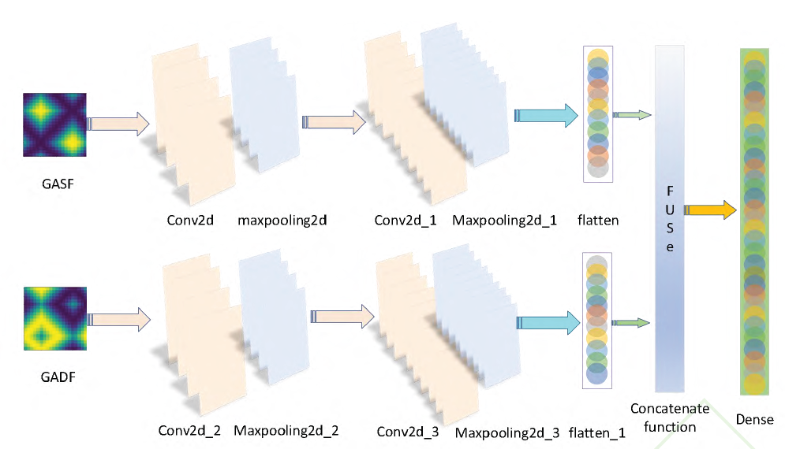
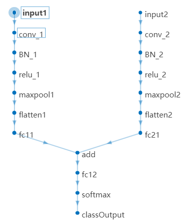
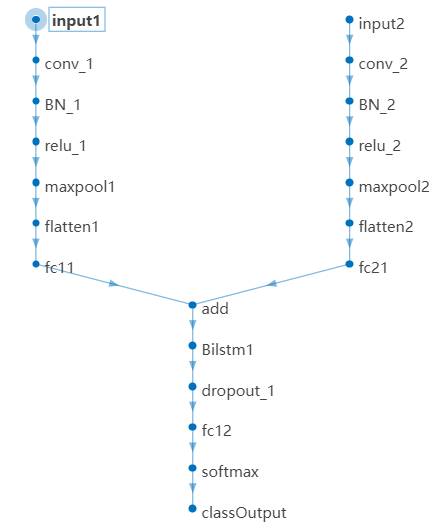
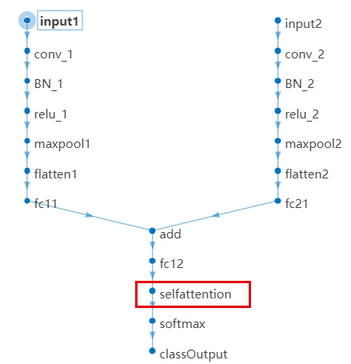
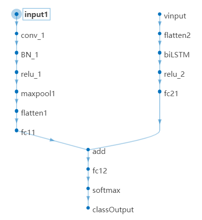
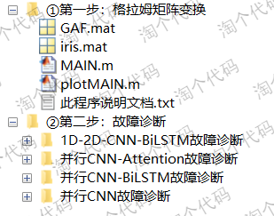
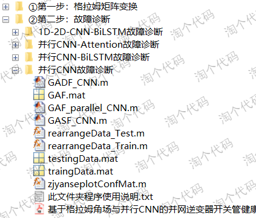
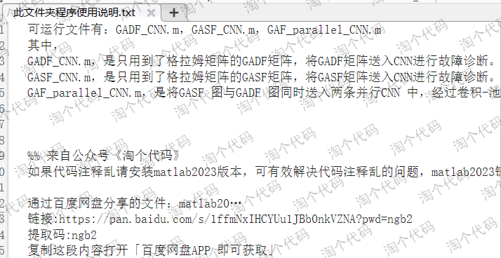
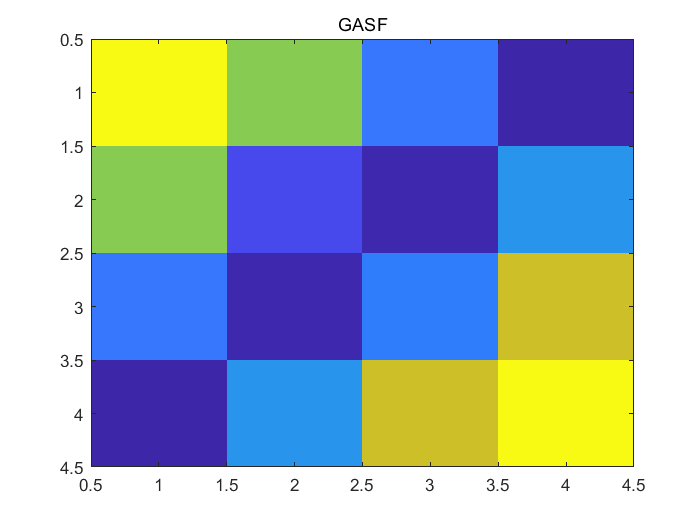
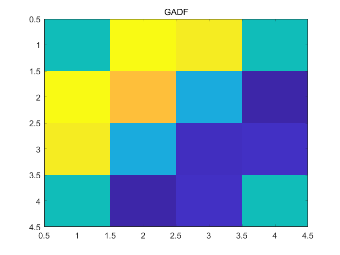
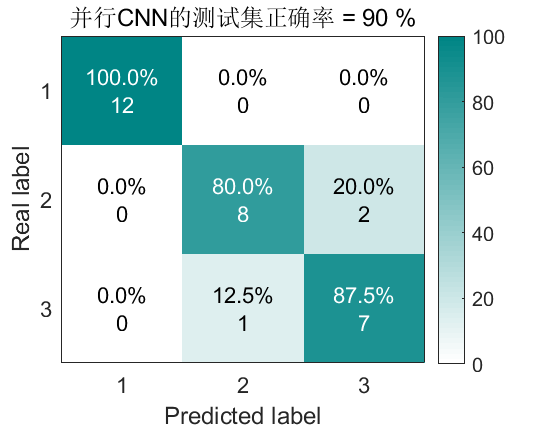
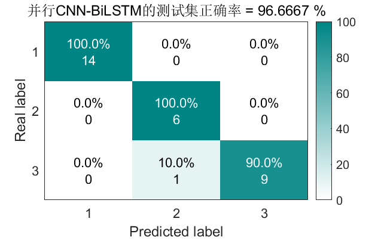
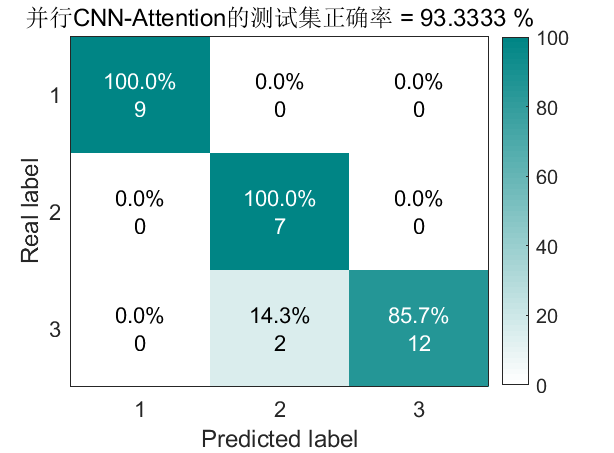
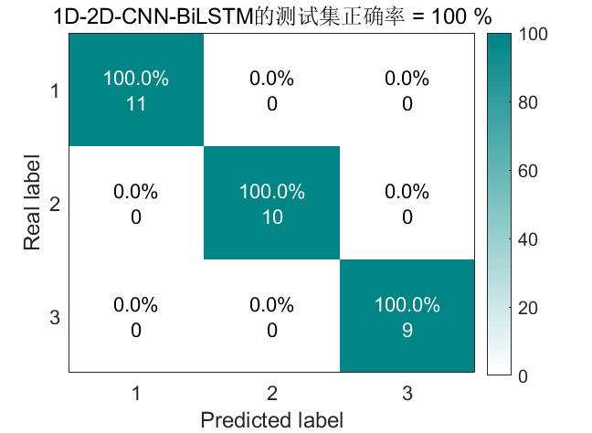
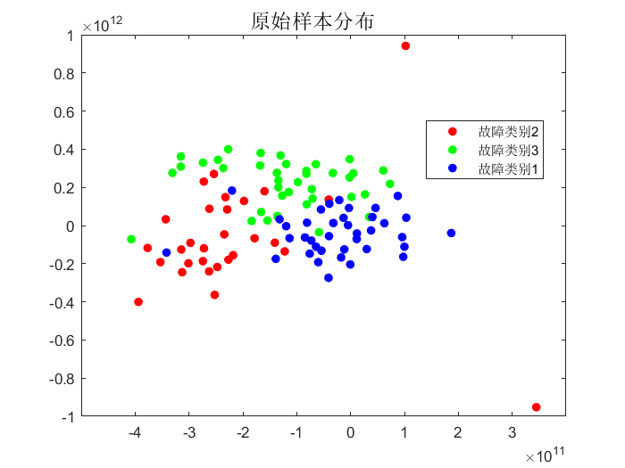
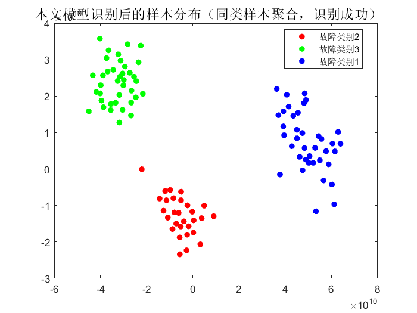

<!-- PAYMENT_BLOCK -->

## Get this dataset

- Payment link (Stripe): [Buy now](https://buy.stripe.com/3cs8yP7sY87d0vu9AB)
- Payment QR code: 

<!-- /PAYMENT_BLOCK -->
